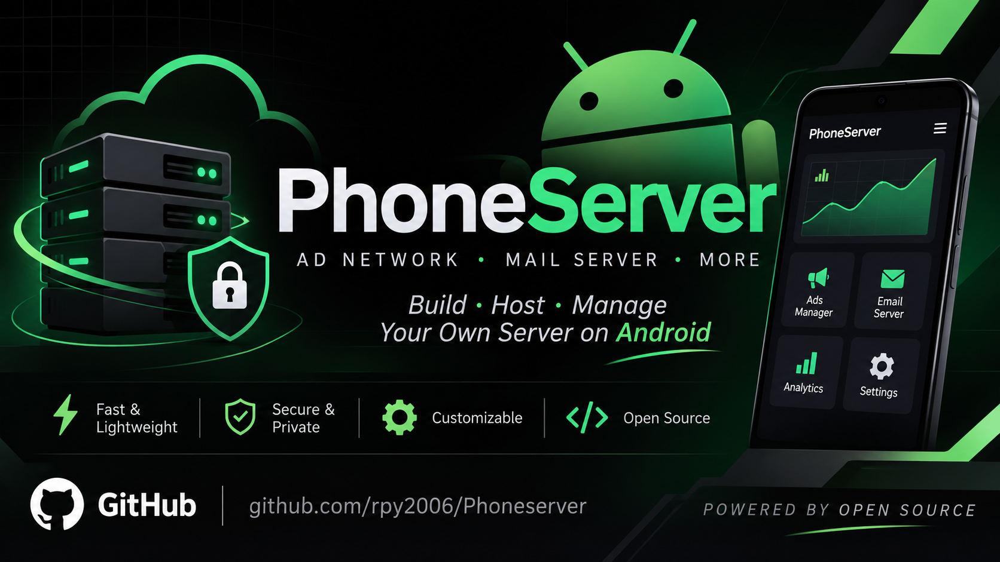

# PhoneServer



PhoneServer is an Android app that turns a phone into a network file server, a small website host, a local JSON API platform, an optional self-hosted ad network, and a client for external SMTP/IMAP mail accounts. It runs in-process on the device; there is no backend service.

- Main HTTP server: `http://<phone-ip>:8080`
- Optional HTTPS listener: `https://<phone-ip>:8443` by default
- Optional Ad Network Manager: `http://<phone-ip>:8090`, off by default
- Minimum Android API: `24`
- Build: one Gradle module (`:app`), Gradle wrapper `9.0.0`, Android Gradle Plugin `8.5.2`, Java source/target `11`

[View the published documentation](https://rpy2006.github.io/Phoneserver/) or start with the [documentation index](docs/README.md).

## Quick start

1. Install the APK on Android API 24 or newer.
2. Grant storage access only for the shared-storage browsing/upload features you intend to use.
3. Start the server from the app and open `http://<phone-ip>:8080/status`.
4. Set an access password or issue a bearer token before exposing protected routes.
5. Configure HTTPS and a public HTTPS origin before creating public share links.

See [installation](docs/getting-started/installation.md), [configuration](docs/getting-started/configuration.md), and [security](docs/security/overview.md).

## What is included

- Local file browsing, upload, download, rename, delete, and hosted website files.
- User-defined JSON endpoints under `/api/<name>`, status/statistics screens, WebDAV, and share links.
- A versioned `/api/v1` JSON API for projects, databases, files, backups, tokens, usage, webhooks, scheduled tasks, settings, and system management. Phase 8 backup/config import/export includes encrypted `.psbak` packages, checksum/manifest validation, import preview/apply with staging/recovery/rollback, and selective restore options.
- A System Management screen and `/api/v1/system/*` routes for live monitoring, automation, diagnostics, logs, maintenance, and server lifecycle control.
- External SMTP/IMAP mail accounts with TLS/STARTTLS, Keystore-protected credentials, inbox/sent/drafts, attachments, and local search.
- An optional ad network with its own port, encrypted JSON store, accounts, campaigns, placements, creatives, tracking, and payouts.
- A small on-device chat surface backed by the bundled `llama_bridge` native library; only `arm64-v8a` is bundled today.
- Built-in offline developer docs with searchable navigation, an API explorer, and an OpenAPI document.

Feature details live in [feature overview](docs/features/overview.md), [mail](docs/features/mail.md), [remote access](docs/features/remote-access.md), and [ad network](docs/features/ad-network.md).

## Repository layout

```text
PhoneServer/
├── app/                          # Android application module (:app)
│   ├── build.gradle              # module dependencies, SDK levels, signing config
│   ├── debug.keystore            # project-local debug signing key
│   ├── proguard-rules.pro        # release shrinker rules
│   └── src/
│       ├── main/
│       │   ├── AndroidManifest.xml
│       │   ├── assets/           # offline docs, ad-network pages, SDK script
│       │   ├── java/com/yadaventerprise/phoneserver/
│       │   │   ├── ads/ ai/ data/ mail/ model/
│       │   │   ├── network/ security/ service/ util/
│       │   │   └── ui/           # one package per screen/feature area
│       │   ├── jniLibs/arm64-v8a/ # bundled llama_bridge native library
│       │   └── res/              # layouts, drawables, menus, values, xml config
│       └── test/                 # Robolectric/unit tests and shared test support
├── docs/                         # canonical Markdown documentation
│   ├── api/ architecture/ development/ features/
│   ├── getting-started/ security/
│   └── development/              # investigation reports and cleanup report
├── gradle/                       # wrapper and version catalog
├── web/data/                     # published-site data bundle
├── index.html                    # published documentation site
├── build.gradle                  # root Android Gradle Plugin declaration
├── settings.gradle               # module inclusion
├── gradle.properties             # Gradle/JVM settings
├── gradlew / gradlew.bat         # Gradle wrapper launchers
├── banner.png                    # README/site banner
└── README.md                     # this file
```

Generated `build/`, `.gradle/`, and IDE cache directories are intentionally not part of the tracked project structure.

## Build and test

Use an Android SDK and a JDK supported by the Gradle wrapper. The test environment used JDK 21 with `ANDROID_HOME=/tmp/android-sdk`.

```sh
ANDROID_HOME=/tmp/android-sdk sh gradlew testDebugUnitTest assembleDebug --offline
```

Latest documented result: `315` tests, `0` failures, `0` errors, `171` skipped. The skipped HTTP/Robolectric tests require a supported x86_64 host. The build emits a non-fatal warning that `libllama_bridge.so` cannot be stripped and is packaged as-is.

See [testing](docs/development/testing.md).

## API

- [HTTP API](docs/api/http-api.md) — legacy/file/website/system routes, auth, WebDAV, sharing, and tokens.
- [Data and storage API](docs/api/data-api.md) — `/api/v1` resource API, including mail.
- [OpenAPI JSON](docs/api/openapi.json) — machine-readable `/api/v1` reference.

## Architecture

The app is split into UI, network, data, security, ads, mail, AI, and docs packages under `app/src/main/java/com/yadaventerprise/phoneserver`. Requests flow through `SimpleHttpServer` into `ServerService`/`DataApi` and platform stores. See [architecture](docs/architecture/overview.md) and [storage layout](docs/architecture/storage.md).

## Documentation map

The canonical Markdown documentation is under [`docs/`](docs/README.md):

| Area | Document |
|---|---|
| Setup | [Installation](docs/getting-started/installation.md), [Configuration](docs/getting-started/configuration.md), [Email setup](docs/getting-started/email-setup.md) |
| Architecture | [Overview](docs/architecture/overview.md), [Storage](docs/architecture/storage.md) |
| Features | [Overview](docs/features/overview.md), [Mail](docs/features/mail.md), [Remote access](docs/features/remote-access.md), [Ad network](docs/features/ad-network.md), [Phase 8 backup](docs/features/phase8-backup-import-export.md) |
| API | [HTTP API](docs/api/http-api.md), [Data API](docs/api/data-api.md), [Remote API](docs/api/remote-api.md), [OpenAPI](docs/api/openapi.json) |
| Security | [Overview](docs/security/overview.md), [Audit](docs/security/audit.md), [Phase 9 authorization matrix](docs/security/phase9-endpoint-authorization-matrix.md) |
| Development | [Testing](docs/development/testing.md), [Changelog](docs/changelog.md), [Cleanup report](docs/CLEANUP_REPORT.md) |
| Investigations | [Startup bug](docs/development/BUG_REPORT.md), [Startup fixes](docs/development/FIX_REPORT.md), [Startup tests](docs/development/TEST_REPORT.md) |

The published site is rendered from `index.html` and `web/data/docs.js`. Files under `app/src/main/assets/docs/` are bundled runtime copies used by the in-app docs viewer.
